# ⚡ Awesome Sales CRM & Pipeline Management 🚀

  <strong>The definitive curated directory of Sales CRM and visual Pipeline Management platforms — spanning battle-tested commercial SaaS market leaders and modern self-hosted open-source software.</strong>

  <em>Supercharge lead acquisition, deal velocity, sales forecasting, contact workflows, visual Kanban stages, AI agent automation, and revenue operations (RevOps).</em>

---

## 📋 Table of Contents

- [🌐 Sector Overview & Market Dynamics](#-sector-overview--market-dynamics)
- [🟦 SaaS / Hosted Platforms](#-saas--hosted-platforms)
- [🟩 Open-Source Software](#-open-source-software)
- [📊 Comparison at a Glance](#-comparison-at-a-glance)
- [🤝 Contributing](#-contributing)
- [💖 Support](#-support)
- [📈 Star History](#-star-history)
- [📄 License](#-license)

---

## 🌐 Sector Overview & Market Dynamics

The global Customer Relationship Management (CRM) market was estimated at **$75.4B in 2023** and is projected to surpass **$157B+ by 2030**, advancing at a compound annual growth rate (CAGR) of ~12–14%, with core Sales Force Automation (SFA) and pipeline management capturing over 65% of enterprise software investment. 📈

The sector is **moderately fragmented**: mega-cap tech giants (Salesforce and HubSpot) dominate top-of-funnel enterprise mindshare and large-scale deployments, while visual-first platforms (Pipedrive, Close, Copper) and an explosive wave of AI-native, developer-centric open-source alternatives (Twenty, Odoo, Frappe CRM, Krayin) aggressively capture high-growth startups, SMBs, and privacy-conscious self-hosters. 🧩

---

## 🟦 SaaS / Hosted Platforms

Below is an overview of commercial, cloud-hosted Sales CRM and Pipeline Management platforms, ranked in descending order of vendor scale (company valuation and market capitalization). 🏢

| Product | Company Size (Valuation / Revenue) 💼 | Core Strengths & Sales Features 🎯 | Starting Tier Pricing 🏷️ | Free Tier Limit / Free Trial 🎁 |
|---|---|---|---|---|
| **[Salesforce Sales Cloud](https://www.salesforce.com/products/sales-cloud/)** | **~$280B+ Market Cap** ($34.8B ARR) | Enterprise CRM benchmark offering deep metadata customization, lead scoring, territory management, advanced forecasting, and massive AppExchange ecosystem. | **$25/user/month** (Starter Suite, billed annually) | **30-day free trial**; evaluation sandbox with pre-loaded sample data |
| **[HubSpot Sales Hub](https://www.hubspot.com/products/sales)** | **~$28B+ Market Cap** ($2.17B ARR) | Inbound-driven sales engagement platform uniting pipeline tracking, automated email sequences, meeting schedulers, and native marketing/service suite sync. | **$15/user/month** (Sales Hub Starter, billed annually) | **Free forever plan**; up to 5 users, 1 deal pipeline per account, 100 contact lists, 1 shared inbox, and standard CRM properties |
| **[Zoho CRM](https://www.zoho.com/crm/)** | **~$1B+ ARR** (Bootstrapped, ~$5B+ estimated valuation) | High-value, comprehensive CRM suite featuring AI assistant (Zia), workflow blueprinting, omnichannel telephony/email, and multi-currency pipeline boards. | **$14/user/month** (Standard edition, billed annually) | **Free forever plan**; up to 3 users with essentials (leads, accounts, contacts, and basic deal tracking) |
| **[Freshsales](https://www.freshworks.com/crm/sales/)** | **~$3.8B Market Cap** ($596M ARR, Freshworks Inc.) | Modern AI-powered sales CRM with built-in cloud telephony, live chat, Freddy AI predictive deal scoring, and automated sales sequences. | **$9/user/month** (Growth edition, billed annually) | **Free forever plan**; up to 3 users with built-in chat, email, phone, contact management, and 1 sales pipeline |
| **[Pipedrive](https://www.pipedrive.com)** | **~$1.5B Acquisition Valuation** (Vista Equity Partners, ~$150M ARR) | Visual-first sales CRM engineered around Kanban pipeline velocity, activity reminders, smart email sync, and actionable closing metrics. | **$14/user/month** (Essential plan, billed annually) | **14-day free trial**; full access across all core features without credit card requirement |
| **[Close](https://www.close.com)** | **~$200M+ Valuation** (Bootstrapped/Profitable, ~$30M+ ARR) | High-velocity inside sales CRM combining multi-channel outbound outreach, power dialers, predictive SMS, email sequences, and Kanban deal pipelines. | **$49/month** (Solo plan includes 1 user seat, billed annually) | **14-day free trial**; full platform access including calling & SMS credits for testing |
| **[Copper](https://www.copper.com)** | **~$150M+ Valuation** (~$35M ARR) | Native Google Workspace CRM built inside Gmail and Google Calendar, automatically harvesting contacts and interactions with zero manual data entry. | **$9/user/month** (Starter tier, billed annually) | **14-day free trial**; complete feature testing with direct Google Workspace integration |
| **[Nutshell](https://www.nutshell.com)** | **~$40M+ Valuation** (~$12M ARR) | Accessible, collaborative CRM for growing teams featuring multiple pipeline board views (Kanban, list, map, chart), email drip campaigns, and unmetered contact storage. | **$16/user/month** (Foundation plan, billed annually) | **14-day free trial**; full access to sales automation, pipeline boards, and reporting |

---

## 🟩 Open-Source Software

Self-hosted, community-driven Sales CRM and Pipeline Management tools. The open-source ecosystem spans **mature enterprise ERP platforms**, **modern developer-friendly CRMs with AI/MCP capabilities**, and **lightweight CLI/Git-native tools**. 💻

Repositories below are ranked in descending order of GitHub star count. ⭐

### 🌟 Repositories by Popularity

* **[Twenty (twentyhq/twenty)](https://github.com/twentyhq/twenty)**  🦄
  * **Stack:** TypeScript, NestJS, React, PostgreSQL | **License:** AGPL-3.0
  * **Overview:** The premier open alternative to Salesforce and HubSpot. Modern visual pipeline interface with custom objects, GraphQL APIs, and native AI integration via Model Context Protocol (MCP) allowing autonomous agents to query and update deal stages.
  * **Ideal For:** High-velocity engineering teams and modern SaaS organizations seeking an extensible, AI-native CRM without proprietary lock-in.

* **[Odoo CRM (odoo/odoo)](https://github.com/odoo/odoo)**  🌐
  * **Stack:** Python, OWL JavaScript, PostgreSQL | **License:** LGPL-3.0
  * **Overview:** Enterprise-grade pipeline management embedded within the world's most widely adopted open-source ERP suite. Provides drag-and-drop opportunity stages, lead enrichment, quotation generation, and automated follow-ups.
  * **Ideal For:** Mid-market and enterprise organizations requiring CRM natively coupled with accounting, inventory, supply chain, and e-commerce.

* **[Krayin CRM (krayin/laravel-crm)](https://github.com/krayin/laravel-crm)**  ⚡
  * **Stack:** PHP, Laravel, Vue.js, MySQL | **License:** MIT
  * **Overview:** High-performance, modular open-source CRM built on the Laravel framework. Features intuitive Kanban deal pipelines, custom lead attributes, multi-channel communication, and role-based access control.
  * **Ideal For:** Laravel developers and SMBs wanting a completely free, MIT-licensed, fast, and customizable CRM foundation.

* **[Comp AI CRM (trycompai/crm)](https://github.com/trycompai/crm)**  🤖
  * **Stack:** TypeScript, Next.js, PostgreSQL | **License:** Open Source
  * **Overview:** Agentic-first open-source CRM engineered specifically for autonomous AI agents and modern sales reps to collaborate on lead triage, qualification, and meeting workflows.
  * **Ideal For:** AI startups and forward-thinking revenue teams pioneering autonomous agent-assisted sales cycles.

* **[IDURAR ERP/CRM (idurar/idurar-erp-crm)](https://github.com/idurar/idurar-erp-crm)**  📦
  * **Stack:** Node.js, Express, React, Redux, MongoDB | **License:** MIT
  * **Overview:** Clean, full-stack JavaScript CRM and invoicing platform with customer tracking, quotation generation, pipeline management, payment logging, and role-based permissions.
  * **Ideal For:** Full-stack JavaScript/MERN developers wanting a turnkey sales management and invoicing dashboard.

* **[Dolibarr ERP CRM (Dolibarr/dolibarr)](https://github.com/Dolibarr/dolibarr)**  🐬
  * **Stack:** PHP, MySQL/PostgreSQL | **License:** GPL-3.0
  * **Overview:** Mature, highly modular CRM and enterprise management system with lead management, commercial proposals, sales orders, contracts, and point-of-sale functionality.
  * **Ideal For:** Freelancers, small businesses, and non-profits seeking an all-in-one business management engine with zero software fees.

* **[SuiteCRM (SuiteCRM/SuiteCRM)](https://github.com/SuiteCRM/SuiteCRM)**  🏢
  * **Stack:** PHP, Symfony, Angular, MariaDB/MySQL | **License:** AGPL-3.0
  * **Overview:** The open-source enterprise standard successor to SugarCRM CE. Full sales-force automation, quote management, customer segmentation, workflow builders, and complex corporate reporting.
  * **Ideal For:** Large enterprises seeking full control over mission-critical CRM infrastructure with strict compliance requirements.

* **[Frappe CRM (frappe/crm)](https://github.com/frappe/crm)**  ☕
  * **Stack:** Python, Frappe Framework, Vue.js | **License:** GPL-3.0
  * **Overview:** A sleek, modern CRM built on the resilient Frappe Framework (creators of ERPNext). Unifies lead tracking, deal pipelines, integrated telephony, WhatsApp messaging, and collaborative deal notes.
  * **Ideal For:** Organizations operating within or exploring the Frappe / ERPNext ecosystem seeking a polished sales frontend.

* **[Fat Free CRM (fatfreecrm/fat_free_crm)](https://github.com/fatfreecrm/fat_free_crm)**  💎
  * **Stack:** Ruby on Rails, PostgreSQL/MySQL | **License:** MIT
  * **Overview:** Classic, elegantly designed Ruby on Rails CRM. Features contact management, visual pipeline tracking, opportunity campaigns, and an active developer plugin architecture.
  * **Ideal For:** Ruby on Rails development shops wanting a clean, hackable, and lightweight CRM codebase.

* **[EspoCRM (espocrm/espocrm)](https://github.com/espocrm/espocrm)**  🛠️
  * **Stack:** PHP, Backbone.js, MySQL/PostgreSQL | **License:** AGPL-3.0
  * **Overview:** Extremely mature, single-page application CRM offering codeless Entity Management, dynamic layouts, automated workflows, email tracking, and calendar synchronization.
  * **Ideal For:** Businesses that need deep administrative customization and complex data relationships without writing code.

* **[BottleCRM / Django-CRM (Django-CRM/Django-CRM)](https://github.com/Django-CRM/Django-CRM)**  🐍
  * **Stack:** Python, Django, PostgreSQL/SQLite | **License:** MIT
  * **Overview:** Modular open-source CRM built in Python & Django with sales pipeline boards, customer tickets, invoice tracking, and RESTful API endpoints.
  * **Ideal For:** Python/Django engineers building custom internal portals or SaaS CRM backends.

* **[OpenCRM (clawnify/OpenCRM)](https://github.com/clawnify/OpenCRM)**  🐾
  * **Stack:** SQLite, REST API, Node.js | **License:** MIT
  * **Overview:** A minimal, lightweight HubSpot alternative engineered for SaaS startups. Provides contact attributes, deal relations, and a clear REST API.
  * **Ideal For:** Micro-SaaS founders and developers needing a compact, headless CRM datastore.

* **[RealTimeX CRM (therealtimex/realtimex)](https://github.com/therealtimex/realtimex)**  ⚡
  * **Stack:** React, TypeScript, Supabase | **License:** MIT
  * **Overview:** Modern CRM architecture with "Bring Your Own Database" via Supabase, Kanban pipeline stages, automated email CC ingestion, and full OAuth support.
  * **Ideal For:** Developers who want a customizable React frontend hooked up directly to a Postgres / Supabase database.

* **[Hermit CRM (Hermit-CRM/hermit-crm)](https://github.com/Hermit-CRM/hermit-crm)**  🐚
  * **Stack:** Python, Markdown, Git | **License:** Open Source
  * **Overview:** A Git-native, local-first CRM where every company, contact, and deal interaction lives as a plaintext Markdown file. Features built-in MCP server support for local AI copilots.
  * **Ideal For:** Technical solo founders, hackers, and developers who prefer Markdown notes and Git versioning over traditional databases.

* **[amagi-crm (amagilabs/amagi-crm)](https://github.com/amagilabs/amagi-crm)**  📟
  * **Stack:** Python, SQLite/PostgreSQL | **License:** Open Source
  * **Overview:** Terminal/CLI-first sales CRM equipped with a pipeline board, stage totals, contact deduplication, and a cryptographic hash verification audit trail.
  * **Ideal For:** Command-line power users seeking immediate CRM operations from their terminal with built-in auditability.

---

## 📊 Comparison at a Glance

| Software 🚀 | Delivery ☁️ | Stack / Architecture ⚙️ | Pipeline Board 📋 | Custom Fields 🎛️ | AI / MCP Ready 🤖 | Open Source 🔓 | Best Fit 💡 |
|---|---|---|:---:|:---:|:---:|:---:|---|
| **Salesforce Sales Cloud** | SaaS | Enterprise Cloud | ✅ | ✅ Deep | ✅ Einstein | ❌ | Large enterprises requiring deep corporate customization |
| **HubSpot Sales Hub** | SaaS | Enterprise Cloud | ✅ | ✅ | ✅ Breeze | ❌ | Inbound marketing + unified sales alignment |
| **Zoho CRM** | SaaS | Cloud Suite | ✅ | ✅ | ✅ Zia | ❌ | High-value, all-in-one suite for growing businesses |
| **Freshsales** | SaaS | Modern Cloud | ✅ | ✅ | ✅ Freddy AI | ❌ | Fast-growing teams needing built-in telephony & chat |
| **Pipedrive** | SaaS | Cloud App | ✅ Visual | ✅ | ❌ | ❌ | Sales reps prioritizing visual pipeline velocity |
| **Close** | SaaS | Cloud App | ✅ | ✅ | ✅ AI Assist | ❌ | High-volume outbound calling & SMS sales teams |
| **Copper** | SaaS | Cloud App | ✅ | ✅ | ❌ | ❌ | Teams operating 100% inside Google Workspace |
| **Nutshell** | SaaS | Cloud App | ✅ Multi-view | ✅ | ❌ | ❌ | Small teams wanting stress-free pipeline automation |
| **Twenty** | Self-Hosted / SaaS | TypeScript / React / Postgres | ✅ | ✅ | ✅ Native MCP | ✅ AGPL-3.0 | Modern developer teams wanting an AI-extensible CRM |
| **Odoo CRM** | Self-Hosted / SaaS | Python / PostgreSQL | ✅ | ✅ | ✅ | ✅ LGPL-3.0 | Organizations wanting CRM unified with ERP & accounting |
| **Krayin CRM** | Self-Hosted | PHP / Laravel / Vue | ✅ | ✅ | ❌ | ✅ MIT | Laravel developers building custom sales pipelines |
| **Comp AI CRM** | Self-Hosted | TypeScript / Next.js / Postgres | ✅ | ✅ | ✅ Agent-Native | ✅ Open | Teams pairing autonomous AI agents with human sales reps |
| **IDURAR ERP/CRM** | Self-Hosted | Node.js / React / Mongo | ✅ | ✅ | ❌ | ✅ MIT | Full-stack JS teams needing CRM & billing dashboards |
| **Dolibarr** | Self-Hosted | PHP / MySQL / Postgres | ✅ | ✅ | ❌ | ✅ GPL-3.0 | SMBs and non-profits wanting modular business software |
| **SuiteCRM** | Self-Hosted | PHP / Symfony / MySQL | ✅ | ✅ | ❌ | ✅ AGPL-3.0 | Enterprise self-hosters replacing legacy systems |
| **Frappe CRM** | Self-Hosted / Cloud | Python / Frappe / Vue | ✅ | ✅ | ❌ | ✅ GPL-3.0 | Frappe and ERPNext users seeking a dedicated sales UI |
| **Fat Free CRM** | Self-Hosted | Ruby on Rails | ✅ | ✅ | ❌ | ✅ MIT | Ruby on Rails shops wanting a lightweight, hackable CRM |
| **EspoCRM** | Self-Hosted / Cloud | PHP / Backbone / MySQL | ✅ | ✅ Entity Mgr | ❌ | ✅ AGPL-3.0 | Power admins wanting no-code entity creation & workflows |
| **BottleCRM** | Self-Hosted | Python / Django | ✅ | ✅ | ❌ | ✅ MIT | Python / Django teams building custom portals |
| **OpenCRM** | Self-Hosted | SQLite / REST API | ✅ | ✅ | ❌ | ✅ MIT | Micro-SaaS founders looking for a simple API datastore |
| **RealTimeX** | Self-Hosted | React / TypeScript / Supabase | ✅ Kanban | ✅ | ❌ | ✅ MIT | React developers desiring a Supabase-backed CRM |
| **Hermit CRM** | Local / Self-Hosted | Python / Markdown / Git | ✅ Board | ✅ | ✅ Native MCP | ✅ Open | Git and Markdown lovers running local AI copilot sales |
| **amagi-crm** | Local CLI | Python / SQLite | ✅ Totals | ❌ | ❌ | ✅ Open | Power users who prefer the terminal and cryptographic audit |

---

## 🤝 Contributing

Contributions are warmly encouraged! 🎉 If you know of an outstanding open-source Sales CRM or Pipeline Management tool that belongs on this list:

1. 🍴 Fork this repository.
2. 🌿 Create a new feature branch (`git checkout -b feature/add-new-crm`).
3. 📝 Add your project under the appropriate category in the table and alphabetical/star order.
4. 🔍 Provide the project name, active repository link, tech stack, license, and what makes it exceptional.
5. 💾 Commit your changes (`git commit -m 'Add AmazingCRM to open-source list'`).
6. 🚀 Push to your branch and open a Pull Request.

*Note: Projects submitted should be actively maintained with recent commits within the past 12 months.*

---

## 💖 Support

A heartfelt thank you to everyone exploring, using, and contributing to this curated repository! 🙌 If this project has saved you engineering time, assisted in selecting the right CRM pipeline stack, or added value to your RevOps strategy, please consider supporting us:

- ⭐ **Star this repository** to show your appreciation and boost visibility on GitHub.
- 🍴 **Fork and share** with colleagues, founders, and developer communities.
- ☕ **Buy me a coffee & support ongoing maintenance** via the [Sponsor Dashboard](https://github.com/sponsors/ishandutta2007) on GitHub Sponsors.

---

##  Star History

---

## 📄 License

This repository is published under the [CC0 1.0 Universal](LICENSE) (Public Domain Dedication). All listed products and repositories remain the property and copyright of their respective authors and companies.
